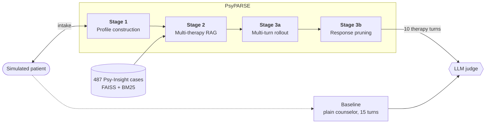

<h1 align="center">PsyPARSE · Reproduction</h1>

<p align="center">
  <b>Retrieval-Augmented Slow Thinking for Personalized Empathetic Counseling</b><br/>
  An independent reimplementation of the AAAI-26 framework on open data and open-weight LLMs
</p>

<p align="center">
  
  
  
  
  
  
</p>

<p align="center">
  <a href="#results">Results</a> ·
  <a href="#quick-start">Quick Start</a> ·
  <a href="#how-it-works">How It Works</a> ·
  <a href="#citation">Citation</a>
</p>

---

## Overview

PsyPARSE (Wang et al., AAAI-26) improves LLM counseling in three steps: it builds a patient profile, retrieves several suitable therapies, and "thinks slowly" by simulating sessions before it answers. The authors did not release code, prompts, weights or their evaluation judge.

This repository rebuilds the complete pipeline from the paper and evaluates it on the English **Psy-Insight** dataset. Everything runs on free hardware (Kaggle, 2× T4) using open-weight models served with Ollama.

**Highlights**

- **All six metrics improve:** PsyPARSE beats a vanilla counselor that uses the same model on every judge metric, by **+18.0** points on average, and wins in **10 / 10** scenarios.
- **Same pattern as the paper:** the largest gains are in *Technical Specificity* (+23.9) and *Strategic Progress* (+23.1), the smallest in *Humanoid Quality* (+8.4).
- **Judge sensitivity:** on the same transcripts, the measured gain ranges from **−0.2** to **+18.0** depending on the judge model. We document how the judge was selected.

---

## Table of Contents

- [Results](#results)
- [How It Works](#how-it-works)
- [Quick Start](#quick-start)
- [Configuration](#configuration)
- [Project Structure](#project-structure)
- [Differences from the Paper](#differences-from-the-paper)
- [Limitations](#limitations)
- [Team](#team)
- [Citation](#citation)

---

## Results

**Setup**

| | |
| :--- | :--- |
| Scenarios | 10 held-out Psy-Insight scenarios |
| Agents | Qwen2.5-14B-Instruct |
| Judge | Gemma-4-31B (thinking off), 3 samples averaged |
| Session length | 5 intake + 10 therapy turns (baseline: 15 turns) |

All scores are on a scale of 10–100. Δ = PsyPARSE − baseline.

| Metric | Baseline | PsyPARSE | Δ | SOP target | Paper Δ (Qwen2.5-32B) |
| :--- | ---: | ---: | ---: | :---: | ---: |
| Coherence | 35.9 | 56.7 | **+20.8** | > +5 ✅ | +9.2 |
| Completeness | 50.5 | 65.9 | **+15.4** | > +8 ✅ | +12.9 |
| Humanoid Quality | 57.8 | 66.2 | **+8.4** | ≥ +5 ✅ | +7.1 |
| Technical Specificity | 48.9 | 72.8 | **+23.9** | > +10 ✅ | +21.9 |
| Strategic Progress | 22.8 | 46.0 | **+23.1** | ≥ +8 ✅ | +14.0 |
| Context Retention | 60.7 | 77.1 | **+16.5** | ≥ +10 ✅ | +15.3 |
| **Average** | **46.1** | **64.1** | **+18.0** | | +13.4 |

95% confidence interval of the average Δ: **[+10.9, +25.1]**.

### Judge sensitivity

The paper does not name its judge. We re-scored the same 20 transcripts with three judges using [`evaluation/rejudge.py`](evaluation/rejudge.py):

| Judge | Baseline | PsyPARSE | Δ | Wins | Score range | Length bias* |
| :--- | ---: | ---: | ---: | :---: | :---: | :---: |
| Qwen2.5-32B | 90.9 | 90.7 | −0.2 | 6 / 10 | 83–94 | 0.73 |
| Gemma-3-27B | 83.1 | 84.7 | +1.6 | 6 / 10 | 75–90 | 0.56 |
| **Gemma-4-31B** | **46.1** | **64.1** | **+18.0** | **10 / 10** | **36–90** | **0.44** |

<sub>*Correlation between the baseline's score and the baseline transcript's length. Lower is better.</sub>

Gemma-4-31B was selected because it uses the full score range, has the lowest length bias, separates a weak and a strong transcript best ([`test_judge.py`](test_judge.py): +60.8 vs +48.3), and comes from a different model family than the agents.

> [!NOTE]
> The judge was selected using these same transcripts, and N = 10. A confirmation run on unseen scenarios has not been done yet.

---

## How It Works



| Stage | What it does | Equations |
| :--- | :--- | :---: |
| **1 · Profile construction** | Runs 5 intake turns with a structured question matrix, then extracts a 6-field patient profile and TF-IDF keywords. | — |
| **2 · Multi-therapy RAG** | Runs a hybrid FAISS + BM25 case search, scores therapy types and keeps the top 3. A guidance plan (techniques and procedural steps) is written for each therapy. | Eq. 1–2 |
| **3a · Multi-turn rollout** | Simulates 3 rounds per therapy on a forked copy of the patient, scoring each reply for empathy and alignment with the plan. The best therapy is selected. | Eq. 3 |
| **3b · Response pruning** | Generates 4 candidate replies per turn, predicts the patient's reaction to each, and sends the reply with the best empathy and stability score. | Eq. 4 |

The **baseline** uses the same LLM with a plain counselor prompt. It talks to the same simulated patient for the same total number of turns, without a profile, retrieval or slow thinking. Both transcripts are judged independently.

---

## Quick Start

### 1. Install

```bash
git clone https://github.com/manishsn7340/PsyParse.git
cd PsyParse/PsyParse            # all commands run from the folder containing config.py
python3 -m venv venv && source venv/bin/activate
pip install -r requirements.txt
```

### 2. Start the model server

```bash
OLLAMA_CONTEXT_LENGTH=32768 ollama serve
ollama pull qwen2.5:14b
ollama pull gemma4:31b
```

> [!IMPORTANT]
> Set `OLLAMA_CONTEXT_LENGTH`. The default context is 2–4k tokens, and Ollama silently cuts off the start of longer prompts.

### 3. Configure

Create `.env` next to `config.py`:

```env
DEEPSEEK_API_KEY=ollama
DEEPSEEK_BASE_URL=http://localhost:11434/v1
DEEPSEEK_MODEL=qwen2.5:14b
JUDGE_MODEL=gemma4:31b
JUDGE_REASONING_EFFORT=none
THERAPY_TURNS=10
```

### 4. Run

```bash
# smoke test (tiny settings, writes to results_quick/)
QUICK_TEST=1 PYTHONPATH=. python evaluation/run_eval.py 2

# judge sanity check: a weak transcript must score clearly below a strong one
PYTHONPATH=. python test_judge.py

# full evaluation on the first N scenarios, resumable
PYTHONPATH=. python evaluation/run_eval.py 10 --resume
PYTHONPATH=. python evaluation/aggregate.py

# re-score saved transcripts with a different judge
JUDGE_MODEL=gemma4:31b JUDGE_REASONING_EFFORT=none MAX_TOKENS=2048 \
  PYTHONPATH=. python evaluation/rejudge.py results/transcripts --resume
```

Platform-specific guides: [Local / Ollama](RUN_LOCALLY.md) · [Kaggle / Colab](RUN_ON_COLAB.md) (used for the reported results) · [Groq API](RUN_ON_GROQ.md)

> A full scenario needs about 200 LLM calls. Ten scenarios take several hours on 2× T4.

---

## Configuration

All settings live in [`config.py`](config.py) and can be overridden with environment variables.

| Variable | Default | Description |
| :--- | :---: | :--- |
| `DEEPSEEK_MODEL` | — | Agent model. The name is historical; any OpenAI-compatible endpoint works. |
| `JUDGE_MODEL` | agent model | Judge model. It should be larger than the agents and from a different family. |
| `JUDGE_BASE_URL`, `JUDGE_API_KEY` | agent endpoint | Lets the judge run on a different server. |
| `JUDGE_SAMPLES` | `3` | Number of judge calls averaged per transcript. |
| `INTAKE_TURNS`, `THERAPY_TURNS` | `5`, `5` | Session length. The reported run uses `THERAPY_TURNS=10`. |
| `ROLLOUT_ROUNDS`, `PRUNING_BRANCHES` | `3`, `4` | Paper values for Stages 3a and 3b. |
| `RAG_TOP_K1`, `RAG_TOP_K2` | `10`, `3` | Cases kept by retrieval and therapies kept after scoring. |
| `ALPHA`, `W1`, `W2` | `0.5` | Weights of Eq. 1 and Eq. 2. |
| `WE_M`, `WT_M`, `TAU_RESP` | `0.5`, `0.5`, `2.5` | Rollout weights and discard threshold (Eq. 3). |
| `WE_S`, `WS` | `0.5`, `0.5` | Pruning weights (Eq. 4). |
| `PARALLEL_CALLS`, `MAX_TOKENS` | `4`, `1024` | Throughput settings. Use `PARALLEL_CALLS=1` for rate-limited APIs. |
| `QUICK_TEST` | `0` | `1` shrinks all settings for smoke tests. |

---

## Project Structure

```
PsyParse/
├── config.py                 # central configuration
├── test_judge.py             # judge discrimination check
├── data/                     # case database, FAISS/BM25 indexes, dev + eval scenarios
├── psyparse/
│   ├── agents/               # therapist, patient and scoring agents; LLM client
│   ├── pipeline/             # stage1 · stage2 · stage3a · stage3b · run_full
│   └── retrieval/            # hybrid search and therapy scoring
└── evaluation/
    ├── run_eval.py           # A/B evaluation (baseline vs PsyPARSE)
    ├── rejudge.py            # re-score saved transcripts
    ├── aggregate.py          # summary table vs SOP targets
    ├── grid_search.py        # alpha / w1 / w2 search on the dev set
    └── judge_prompt.txt      # six-metric rubric
```

---

## Differences from the Paper

<details>
<summary>Implementation choices where the paper is unspecified or resources were unavailable</summary>
<br/>

| Component | Paper | This repository |
| :--- | :--- | :--- |
| LLM backend | GPT-4, Qwen2.5, LLaMA-3.x, DeepSeek-V3 | Qwen2.5-14B-Instruct (Ollama) |
| Data | CPsyCounR / CPsyCounE (Chinese) | Psy-Insight (English): 487 database cases, 20 eval + 4 dev scenarios |
| *M_s* (Eq. 2) | Symptom match (Jaccard) | Cosine similarity between the profile and therapy-type embeddings |
| *A* (Eq. 3) | "Keyword / semantic similarity" | MiniLM cosine between the reply and the therapy's techniques and steps |
| Eq. 4 scoring | Not specified | All 4 candidates scored jointly in two orders and averaged, to cancel position bias |
| Unknown weights | Not published | Neutral 0.5; τ_resp = 2.5 |
| Judge | Unnamed LLM, rubric in an unpublished appendix | Gemma-4-31B with our rubric |
| Human evaluation | Certified counselors | Team review of 5 transcript pairs |

</details>

---

## Limitations

- Results come from a single run of 10 scenarios, with no repeated seeds.
- The size of the gain depends strongly on the judge model.
- The patient and the judge are both simulated by LLMs. There was no rating by human experts.
- The dataset's labelled therapy was among the top-3 retrieved therapies in 4 of 10 scenarios.
- Commit `3ea0103` (full therapy names in prompts) was added after the evaluation run and has not been evaluated.

> [!WARNING]
> This is a research and course project. It is not a medical device and must not be used for real counseling, diagnosis or crisis support.

---

## Team

**E.D.I.T.H**

| Name | Roll No. | Contribution |
| :--- | :--- | :--- |
| Manish Shroyan | B24CS026 | Therapy database, FAISS + BM25 hybrid retrieval, pipeline |
| Mitu Kumar | B24CS029 | Patient / therapist agents, profile construction, therapy matching |
| Shivam Chaurasia | B24CS039 | Rollout + pruning (slow thinking), evaluation, report |

---

## Citation

If you use this work, please cite the original paper and the dataset:

```bibtex
@inproceedings{wang2026psyparse,
  title     = {PsyPARSE: Retrieval-Augmented Slow Thinking for Personalized Empathetic Counseling},
  author    = {Wang, Longxiang and Zhao, Pukun and Chen, Chen and Bi, Jinhe and Wang, Huacan and Zhang, Tong and Chen, Ronghao},
  booktitle = {Proceedings of the AAAI Conference on Artificial Intelligence (AAAI-26)},
  year      = {2026}
}

@article{chen2025psyinsight,
  title   = {Psy-Insight: Explainable Multi-turn Bilingual Dataset for Mental Health Counseling},
  author  = {Chen and Sun and Wen and Lian and Gao and Li},
  journal = {arXiv preprint arXiv:2503.03607},
  year    = {2025}
}
```

## Acknowledgements

- The authors of PsyPARSE, for a detailed method description.
- The [Psy-Insight](https://github.com/ckqqqq/Psy-Insight) team, for releasing the dataset.
- [Ollama](https://ollama.com), Qwen and Gemma, for the open-weight models.
- Kaggle, for free GPU compute.
