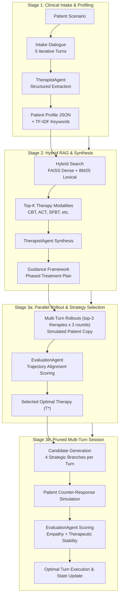

# PsyParse 🧠
### *Adaptive Multi-Agent Psychotherapy Simulation & Evidence-Based Clinical Reasoning*

[](https://www.python.org/)
[](LICENSE)
[]()
[]()
[]()

---

## Overview

**PsyParse** is a modular, multi-agent AI framework designed to simulate, adapt, and evaluate therapeutic dialogues using evidence-based clinical methodologies. Grounded in computational psychotherapy research, PsyParse models clinical encounters across four distinct phases: structured diagnostic intake, hybrid therapeutic knowledge retrieval, parallel trajectory rollout, and real-time branch-pruned dialogue generation.

By orchestrating specialized LLM agents (`TherapistAgent`, `PatientAgent`, and `EvaluationAgent`), PsyParse enables reproducible research into automated therapeutic alliance, technique adherence, and patient affective modeling without requiring live clinical interventions.

---

## System Architecture



---

## Core Pipeline Stages

| Stage | Module | Description | Clinical Purpose |
| :--- | :--- | :--- | :--- |
| **Stage 1: Diagnostic Intake** | [`stage1.py`](psyparse/pipeline/stage1.py) | 5-turn intake between `TherapistAgent` and `PatientAgent`, one question-matrix topic per turn, adapted to what the patient just said. The simulated patient gets a persona built once per scenario from the background plus the client's own lines in the real session (`get_persona`); its opening line is written from that persona. Both are shared with the baseline. | Extracts a 6-field patient profile JSON (`core_problems`, `emotional_states`, `symptoms`, `cognitive_distortions`, `interpersonal_issues`, `therapeutic_goals`) and TF-IDF keywords from the patient's own words. |
| **Stage 2: Hybrid Retrieval & Synthesis** | [`stage2.py`](psyparse/pipeline/stage2.py), [`hybrid_search.py`](psyparse/retrieval/hybrid_search.py) | Eq. 1: `α·cos(FAISS) + (1-α)·BM25`. Eq. 2: therapy score `w1·M_s + w2·App`. Drops the bottom 30% and keeps the top-3 distinct therapy types. | `TherapistAgent` writes one guidance framework (techniques + procedural steps) per retrieved therapy. |
| **Stage 3a: Multi-Turn Rollout** | [`stage3a.py`](psyparse/pipeline/stage3a.py) | For each retrieved therapy: 3 simulated rounds on a forked copy of the patient, spread over the therapy plan. Replies scoring below `τ_resp` are regenerated (Eq. 3). Rollouts run in parallel. | Score = mean $S_{resp}$ + a side-by-side comparison of the rollouts (empathy, alignment, progress); picks the best one ($T^*$). The real patient is never touched. |
| **Stage 3b: Response Pruning** | [`stage3b.py`](psyparse/pipeline/stage3b.py) | Each turn: 4 candidate replies (Cognitive, Emotional, Behavioral, Socratic angle), each following the current step of the treatment plan. | Simulates the patient's reaction to each candidate, scores empathy + stability (Eq. 4), and sends the best one to the real patient. |

---

## Repository Structure

```
PsyParse/                         # (the inner folder, run everything from here)
├── config.py                     # all parameters; most can be overridden via .env / shell
├── requirements.txt
├── .env                          # API / model settings (gitignored, you create it)
├── test_judge.py                 # checks the judge prefers a strong transcript over a weak one
├── RUN_LOCALLY.md                # how to run with Ollama on your machine
├── RUN_ON_COLAB.md               # how to run on Google Colab / Kaggle
├── RUN_ON_GROQ.md                # how to run with the Groq API
├── data/
│   ├── dev_scenarios.json        # 4 dev scenarios (used for the grid search)
│   ├── eval_scenarios.json       # 20 evaluation scenarios (Psy-Insight)
│   ├── therapy_database.json     # 487 cases, 13 therapy types
│   ├── therapy_faiss.index       # FAISS index of case profiles
│   ├── therapy_bm25.pkl          # BM25 index of therapy tags
│   └── app_table.json, therapy_types.json, *.npy   # App scores, therapy type embeddings
├── evaluation/
│   ├── run_eval.py               # baseline vs PsyParse A/B evaluation
│   ├── grid_search.py            # alpha x (w1, w2) grid search on the dev set
│   ├── aggregate.py              # summary table vs SOP targets
│   └── judge_prompt.txt          # 6-axis judge rubric
├── psyparse/
│   ├── agents/
│   │   ├── base_agent.py         # LLM client, retries, output cap, transcript helpers
│   │   ├── therapist_agent.py    # interview, guidance synthesis, step-aware replies
│   │   ├── patient_agent.py      # simulated patient with snapshot / fork
│   │   └── evaluation_agent.py   # rollout, pruning and trajectory scoring
│   ├── pipeline/
│   │   ├── run_full.py           # runs stages 1 -> 3b
│   │   └── stage1.py, stage2.py, stage3a.py, stage3b.py
│   └── retrieval/
│       └── hybrid_search.py      # FAISS + BM25 retrieval and therapy scoring
├── results/                      # eval_results.json, summary_table.md, transcripts/
└── results_quick/                # same, for QUICK_TEST runs (not real results)
```

---

## Getting Started

Pick a setup guide. Each one has the full step-by-step commands:

| Guide | Use when |
| :--- | :--- |
| [`RUN_LOCALLY.md`](RUN_LOCALLY.md) | you have a GPU and want to run with Ollama, no API limits |
| [`RUN_ON_COLAB.md`](RUN_ON_COLAB.md) | you want a free GPU on Google Colab or Kaggle |
| [`RUN_ON_GROQ.md`](RUN_ON_GROQ.md) | you have no GPU and use the Groq API (free tier has daily limits) |

Short version (Ollama). Run everything from the inner `PsyParse` folder (the one with `config.py`) with `PYTHONPATH=.`:

```bash
git clone https://github.com/manishsn7340/PsyParse.git
cd PsyParse/PsyParse              # existing copy (e.g. ~/aa_ML/Project): cd PsyParse
python3 -m venv venv && source venv/bin/activate
pip install -r requirements.txt
```

`.env` in that folder:
```env
DEEPSEEK_API_KEY=ollama
DEEPSEEK_BASE_URL=http://localhost:11434/v1
DEEPSEEK_MODEL=qwen2.5:14b
JUDGE_MODEL=qwen2.5:32b      # the judge must be bigger than the agents
```
(The `DEEPSEEK_*` names are left over from the original plan; any OpenAI-compatible endpoint works.)

---

## Execution

```bash
# 1. quick test: tiny settings, finishes in minutes, results in results_quick/ (NOT real numbers)
QUICK_TEST=1 PYTHONPATH=. python evaluation/run_eval.py 2

# 2. check the judge can tell a weak transcript from a strong one
PYTHONPATH=. python test_judge.py

# 3. tune alpha / w1 / w2 on the dev set
PYTHONPATH=. python evaluation/grid_search.py

# 4. final A/B evaluation (SOP: N >= 10 scenarios, 10 therapy turns)
THERAPY_TURNS=10 ALPHA=0.5 W1=0.5 W2=0.5 PYTHONPATH=. python evaluation/run_eval.py 10 --resume

# demo: run the pipeline on one dev scenario and print the transcript
PYTHONPATH=. python -m psyparse.pipeline.run_full
```

---

## Hyperparameters & Settings

All in [`config.py`](config.py). Values marked *Paper* come from the paper's implementation details / SOP Table VI.

| Parameter | Type | Default | Meaning |
| :--- | :--- | :--- | :--- |
| `ROLLOUT_ROUNDS` | Paper | `3` | simulated rounds per therapy in Stage 3a |
| `PRUNING_BRANCHES` | Paper | `4` | candidate replies per turn in Stage 3b |
| `RAG_TOP_K1` | Fixed | `10` | cases kept after hybrid retrieval (Eq. 1) |
| `RAG_TOP_K2` | Paper | `3` | therapy types kept after scoring (Eq. 2) |
| `RAG_DROP_FRAC` | Fixed | `0.3` | bottom fraction dropped before picking therapies |
| `ALPHA` | Tunable | `0.5` | dense (FAISS) vs lexical (BM25) weight, grid {0.3, 0.5, 0.7} |
| `W1`, `W2` | Tunable | `0.5`, `0.5` | weights of symptom match $M_s$ and applicability $App$ (Eq. 2) |
| `WE_M`, `WT_M`, `TAU_RESP` | Tunable | `0.5`, `0.5`, `2.5` | rollout empathy / alignment weights and discard threshold (Eq. 3) |
| `WE_S`, `WS` | Tunable | `0.5`, `0.5` | pruning empathy / stability weights (Eq. 4) |
| `TEMP_SINGLE` | Fixed | `0.7` | temperature for candidate replies |
| `INTAKE_TURNS`, `THERAPY_TURNS` | Fixed / env | `5`, `5` | dialogue length; final run uses `THERAPY_TURNS=10` (baseline gets intake + therapy turns) |
| `JUDGE_MODEL`, `JUDGE_SAMPLES` | env | agent model, `3` | judge model (should be bigger) and number of averaged judge runs |
| `QUICK_TEST` | env | `0` | `1` = tiny settings for smoke tests |
| `PARALLEL_CALLS`, `MAX_TOKENS`, `CTX_LIMIT` | env | `4`, `1024`, `12288` | speed / safety settings, see the run guides |

---

## Clinical Evaluation Dimensions

Each transcript (baseline and PsyParse, judged separately) is scored by an LLM judge using [`judge_prompt.txt`](evaluation/judge_prompt.txt) on a 1.0–10.0 scale, reported ×10 (10–100) like the paper. The baseline is the same LLM as a plain counselor: no profile, no retrieval, no slow thinking, and the same number of turns. The reported number is **Δ = PsyParse − baseline**, compared with the SOP targets (`Coh > +5, Cpl > +8, Tec > +10, Hum ≥ +5, Str ≥ +8, Ctx ≥ +10`).

1. **Coherence (Coh.)**: logical flow and smooth topical transitions.
2. **Completeness (Cpl.)**: how thoroughly the patient's problems, symptoms and emotions are explored.
3. **Humanoid Quality (Hum.)**: warmth, emotional resonance and anticipatory empathy.
4. **Technical Specificity (Tec.)**: explicit execution of evidence-based techniques (e.g., CBT restructuring, SFBT scaling questions).
5. **Strategic Progress (Str.)**: phased movement from exploration to intervention and insight.
6. **Contextual Personalization (Ctx.)**: use of the patient's personal background and details.

---

## Ethical & Safety Notice

> **IMPORTANT DISCLAIMER**  
> PsyParse is developed exclusively as a **computational research and simulation framework**. It is **not** a certified medical device, does not provide clinical diagnostic services, and is not a substitute for professional mental health care or crisis intervention. Do not use this software for actual psychiatric treatment or real-world clinical decision-making.

---

## License

This project is licensed under the [MIT License](LICENSE).
